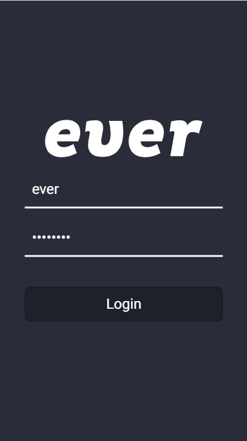
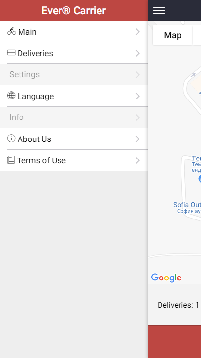
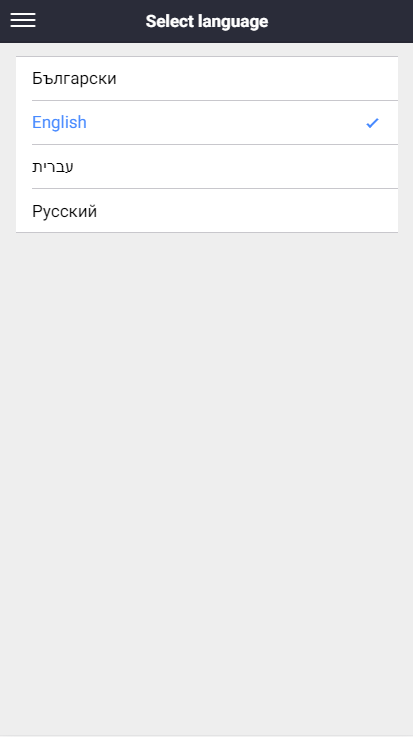
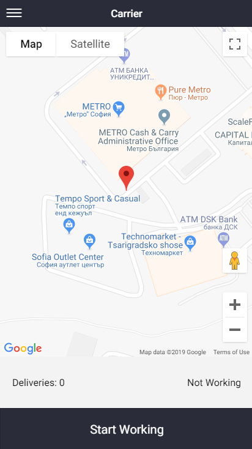
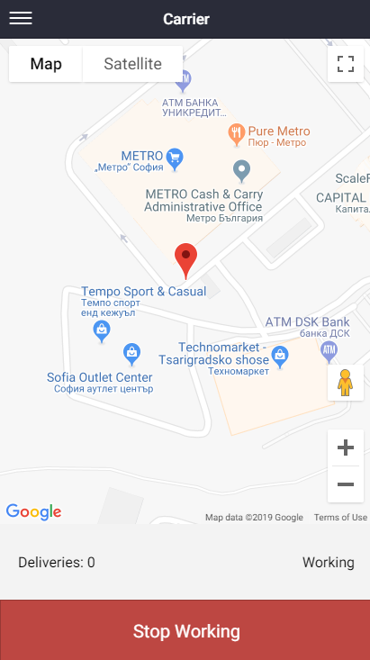
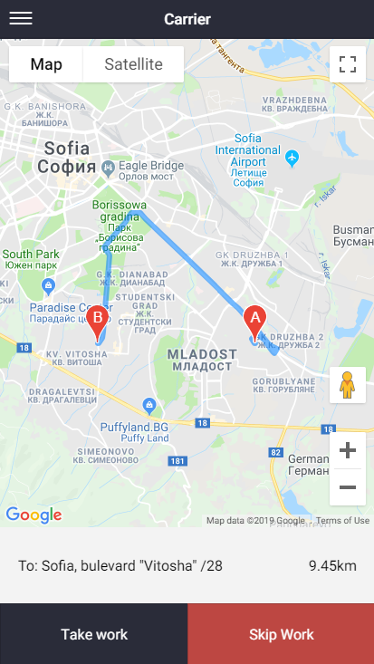
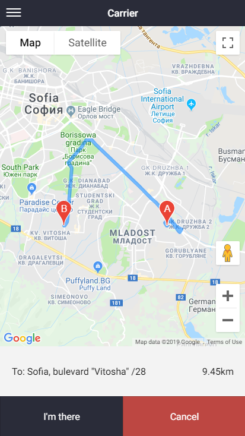
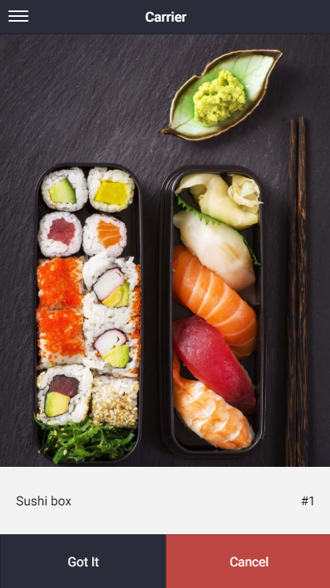
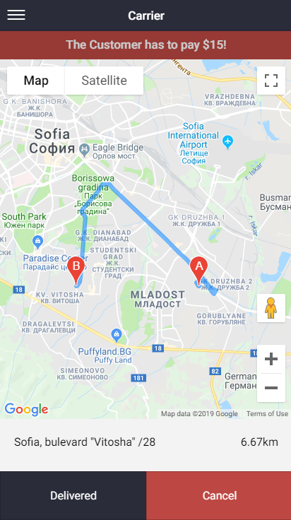
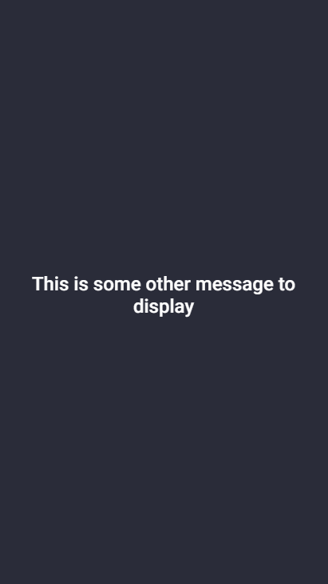

# Carrier App Guide

The **Carrier app** (shown in the app as **Ever® Carrier**) is the mobile app that couriers use to receive and complete deliveries. This guide walks through a carrier's first session: signing in, finding your way around, choosing a language, going on duty, and completing a job.

:::note
The screenshots on this page come from an earlier release of the app. Layout, wording and map styling may differ slightly in the version you run. For what the customer sees while a carrier is delivering, see [Live Tracking](live-tracking.md).
:::

## Sign in

Open the app and enter your carrier **username** and **password**, then tap **Login**.

## Navigate with the side menu

Tap the menu (hamburger) icon in the top-left corner of any screen to open the side menu. It contains these entries:

| Entry | Notes |
| --- | --- |
| **Main** | The map screen where you go on duty and work on deliveries |
| **Deliveries** | Opens the deliveries screen |
| **Language** | Opens the language picker |
| **About Us** | Information about the product |
| **Terms of Use** | The terms of use |

**Settings** and **Info** appear greyed out in the menu and cannot be opened.

## Choose a language

Open **Language** from the side menu to pick the language of the app. The picker in the screenshot lists Bulgarian (Български), English, Hebrew (עברית) and Russian (Русский); the current language is marked with a check mark.

## Go on duty

The **Main** screen shows a map with your position. At the bottom you see the number of deliveries and your current state.

When you have not started your shift, the state is **Not Working** and the button at the bottom reads **Start Working**. Tap it to go on duty.

Once you are on duty, the state changes to **Working** and the button becomes the red **Stop Working**. Tap it to end your shift.

## Complete a delivery

While you are on duty, an order can be offered to you. Each job moves through the following screens:

1. **Accept or skip.** The map shows the route from point **A** to point **B**, the delivery address and the distance. Tap **Take work** to accept the job or **Skip Work** to pass on it.

   

2. **Head to the location.** After you accept, the screen keeps the route and the address, and offers **I'm there** and **Cancel**. Tap **I'm there** when you have arrived.

   

3. **Collect the products.** The screen shows each product of the order, with its name and number. Tap **Got It** once you have it, or **Cancel** to back out.

   

4. **Deliver.** A banner shows the amount the customer has to pay, and the map shows the route and remaining distance to the customer. Tap **Delivered** when you hand the order over, or **Cancel** to back out.

   

## Maintenance message

The app has a full-screen message screen that replaces its normal screens. The screenshot below shows placeholder text ("This is some other message to display"); the wording you see in your installation may differ.

## Related guides

- [Live Tracking](live-tracking.md): the same delivery from the carrier's and the customer's point of view.
