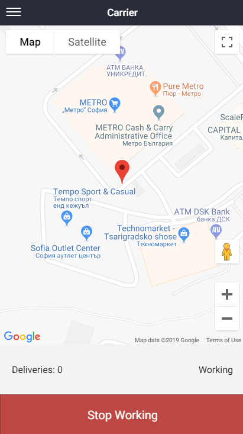
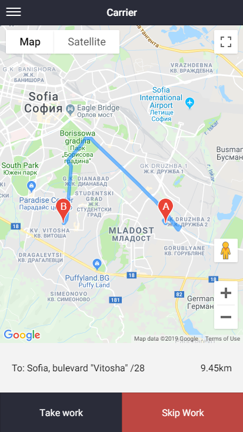
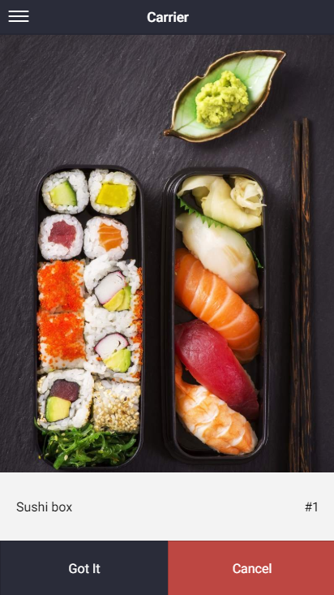
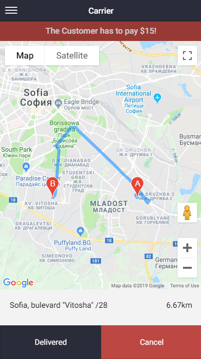
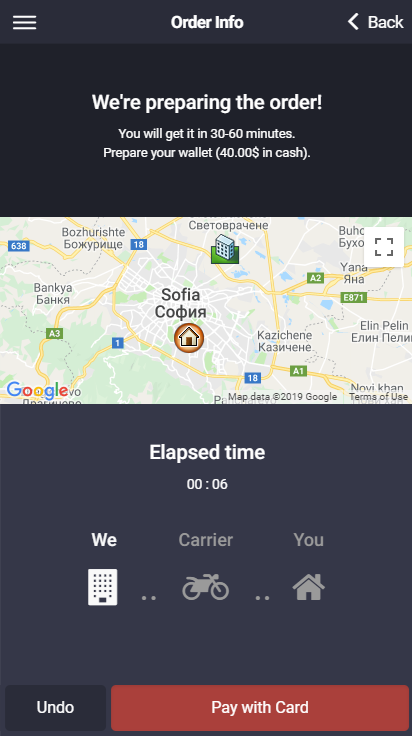
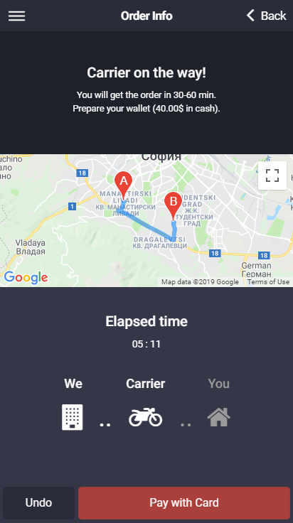
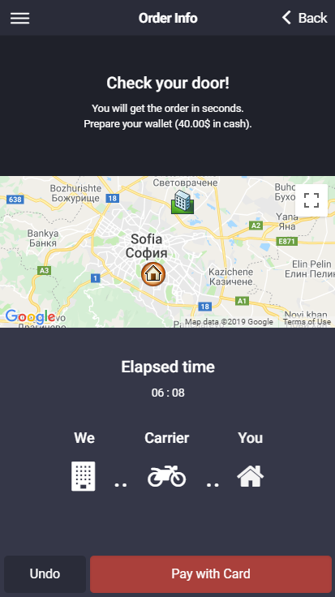
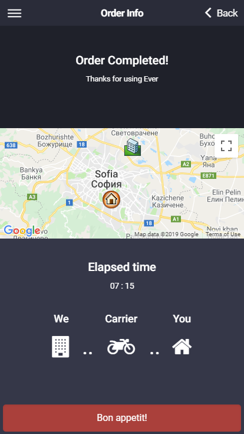
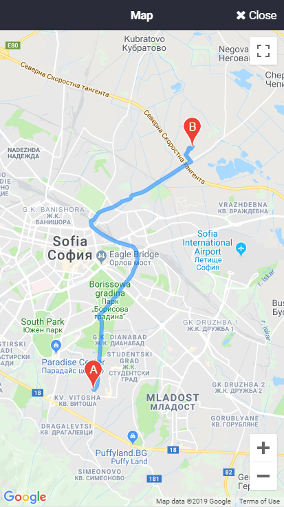

# Live Tracking for On-Demand Deliveries

This guide follows one on-demand delivery from the moment a carrier takes the job to the moment the customer sees it completed. It describes what each side sees in the **Carrier app** and in the customer **Shop (mobile) app**.

:::note
The screenshots on this page come from an earlier release of the apps. Layout, wording and map styling may differ slightly in the version you run.
:::

## How the flow fits together

| Step | Who | What they see |
| --- | --- | --- |
| 1. Go on duty | Carrier | Map with their position, the delivery count, their state and a **Stop Working** button |
| 2. Receive a job | Carrier | Route from pickup (**A**) to drop-off (**B**), the delivery address, the distance, and **Take work** / **Skip Work** |
| 3. Pick up the order | Carrier | The ordered products with **Got It** / **Cancel** |
| 4. Deliver | Carrier | Route to the customer, the amount the customer pays, and **Delivered** / **Cancel** |
| 5. Follow the order | Customer | **Order Info** screen: status message, map, elapsed time and a **We → Carrier → You** progress indicator |

## Carrier: go on duty

A carrier signs in to the Carrier app and starts working. While on duty, the screen shows the map, the number of deliveries and the current state (**Working**). The red **Stop Working** button ends the shift.

## Carrier: dispatch and acceptance

When an order is offered to the carrier, the map shows the route from point **A** to point **B**, together with the delivery address and the distance. The carrier either accepts the job with **Take work** or passes on it with **Skip Work**.

## Carrier: pick up and deliver

After accepting, the carrier sees the products to collect and confirms with **Got It** (or backs out with **Cancel**).

On the way to the customer, the map shows the route, the remaining distance and the amount the customer has to pay. When the order is handed over, the carrier taps **Delivered**.

## Customer: follow the order

Once the customer has placed an order, the **Order Info** screen of the Shop app tracks it. It shows:

- a **status message** that changes as the order progresses;
- a **map** that can be expanded to full screen;
- an **elapsed time** counter;
- a three-step indicator, **We** (the store), **Carrier** and **You**, which highlights the current stage.

The customer sees these stages in order:

1. **Preparing the order.** The store is preparing the order. The map shows the store and the delivery address.

   

2. **Carrier on the way.** The map shows the route between the carrier and the delivery address.

   

3. **Check your door.** The carrier is about to arrive.

   

4. **Order Completed.** The delivery is finished.

   

The map can be opened full screen for a larger view of the route.

