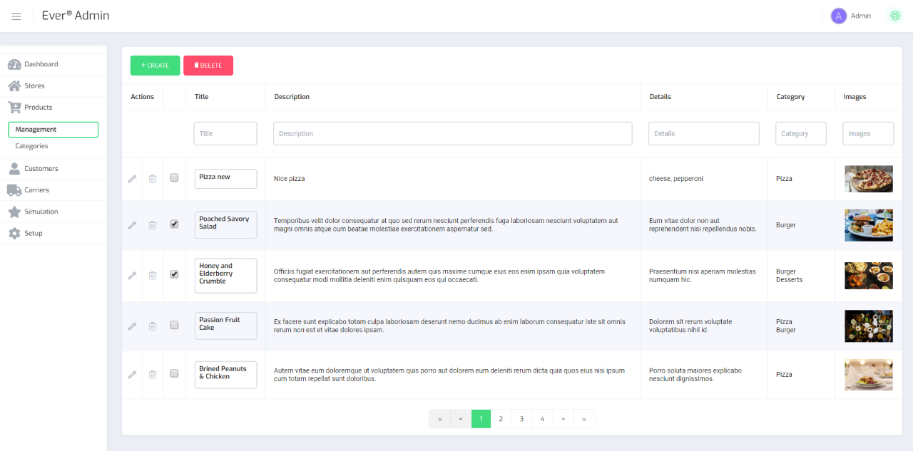
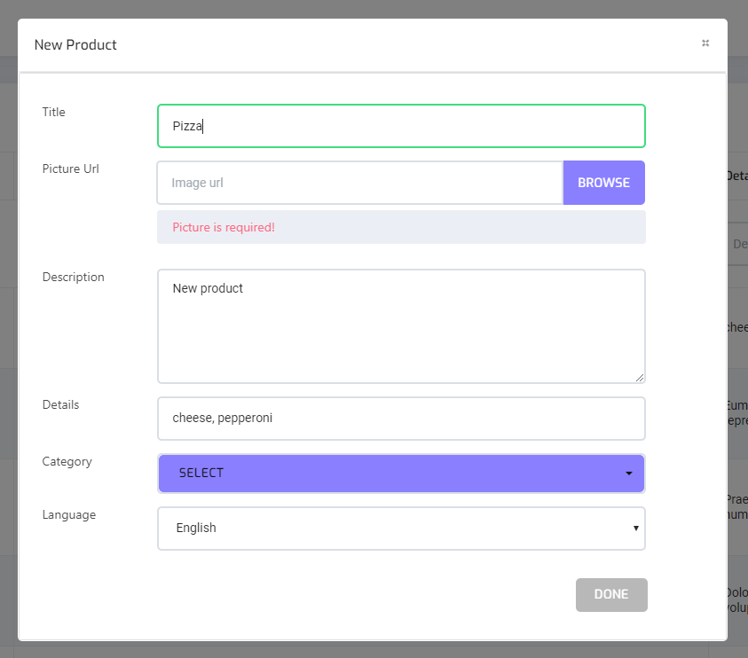
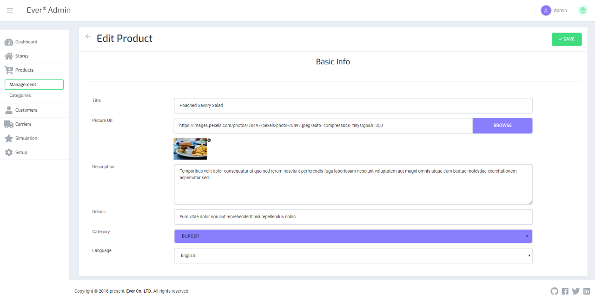
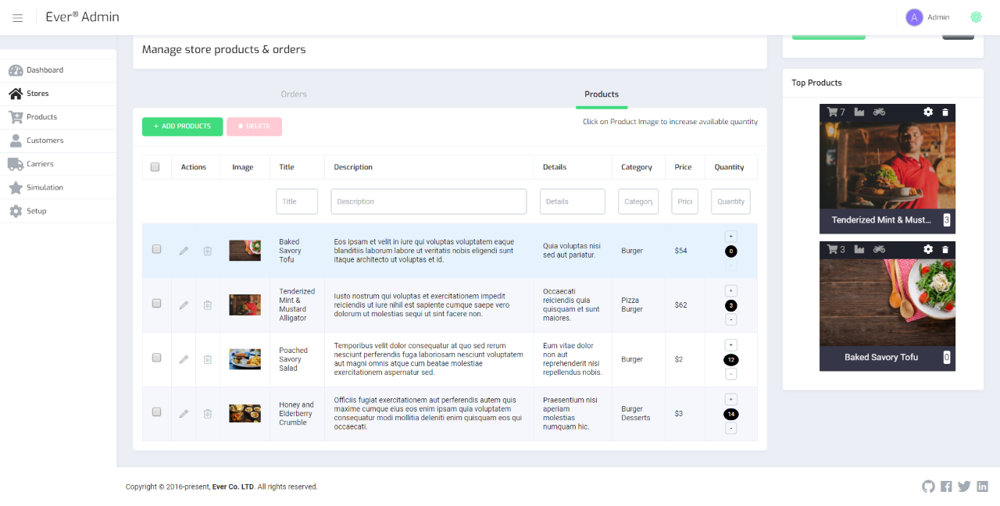
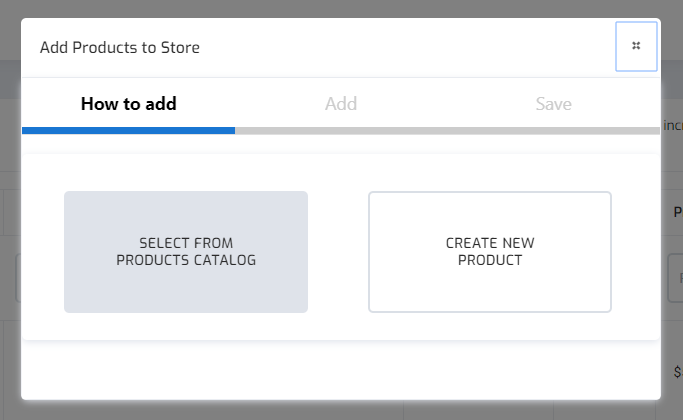
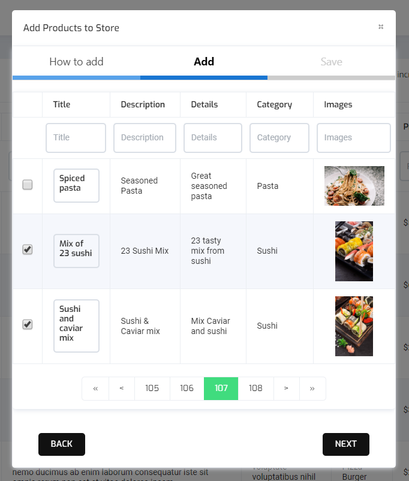
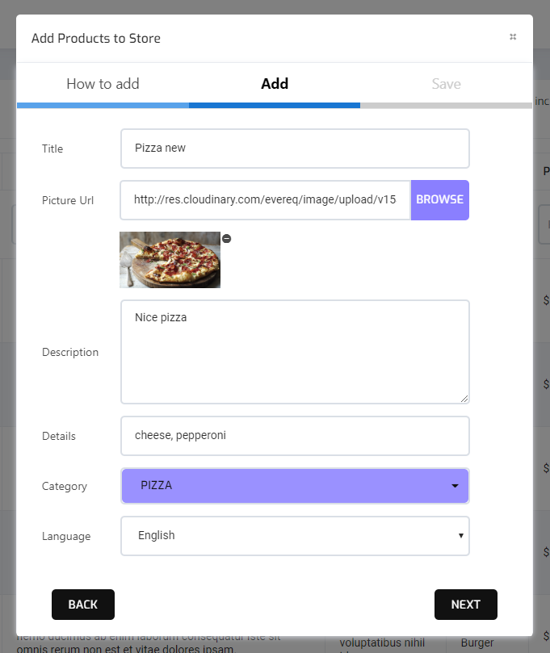
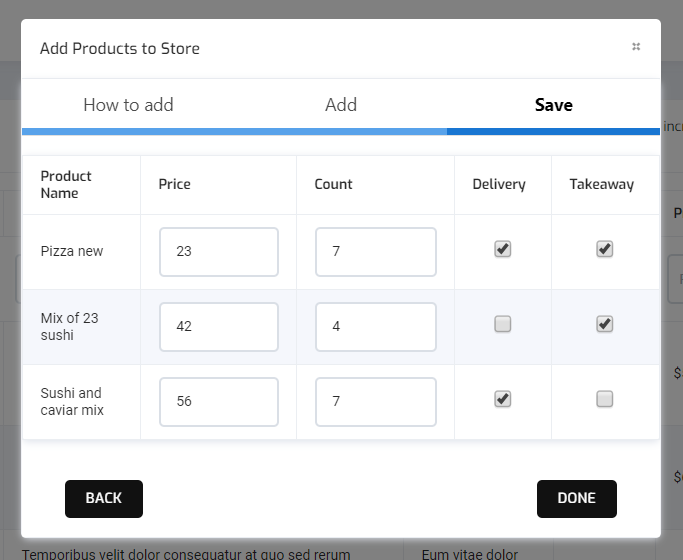
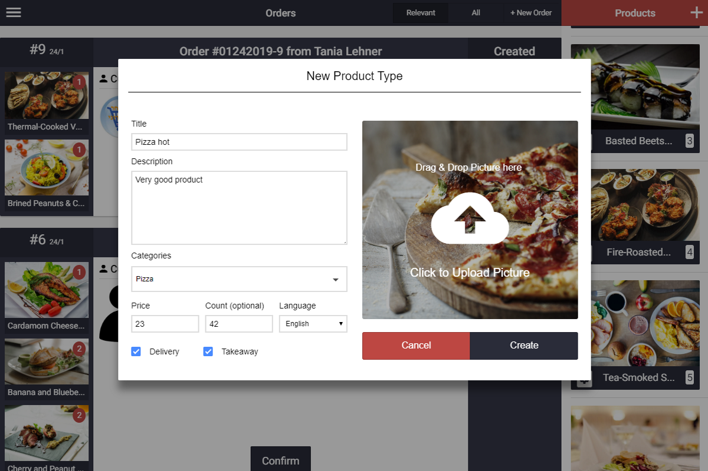

# Product Catalog and Store Inventory

This guide explains how products are managed in the **Admin** website and in the **Merchant** app: the shared **products catalog**, the products offered by each **store**, and the price and available quantity of each one.

:::note
The screenshots on this page come from an earlier release of the apps. Layout, wording and styling may differ slightly in the version you run. This page describes only what these screens show.
:::

## Catalog vs. store products

Products are handled on two levels:

| Level | Where | What it holds |
| --- | --- | --- |
| **Products catalog** | Admin: **Products → Management** | The product itself: title, picture, description, details, category and language |
| **Store products** | Admin: **Stores →** select a store **→ Products** tab; Merchant app: **Products** panel | The products a store offers, each with its own **Price**, available quantity (**Count**) and whether it is offered for **Delivery**, **Takeaway** or both |

A product is first described once in the catalog. A store then adds it to its own list and sets the price and quantity for that store.

## Admin: manage the products catalog

Open **Products → Management** in the side menu. The page lists all catalog products with their title, description, details, category and image. You can filter each column, move between pages, and use the row actions to edit or delete a product.

### Create a product

1. Click **Create**.
2. Fill in the **New Product** form:
   - **Title**
   - **Picture Url** (enter an image address or use **Browse**). A picture is required; the form shows *Picture is required!* until one is set.
   - **Description**
   - **Details**, a short line such as the main ingredients
   - **Category**, chosen from the list
   - **Language**
3. Click **Done**.

### Edit a product

Click the pencil icon in the product row. The **Edit Product** page shows the same **Basic Info** fields. Change what you need and click **Save**.

Categories are managed under **Products → Categories**.

## Admin: add products to a store

Open **Stores**, select a store and switch to its **Products** tab. The table shows each product with its image, title, description, details, category, **Price** and **Quantity**. The **Add Products** button starts the wizard; products are removed with the trash icon in the row, or with **Delete** after ticking several rows.

### Step 1: How to add

Choose how the products enter the store:

- **Select from Products Catalog**, to reuse products that already exist;
- **Create New Product**, to describe a new product on the spot.

### Step 2: Add

**From the catalog:** tick the products you want. The table can be filtered by title, description, details, category and images, and paged.

**New product:** fill in the same fields as in the catalog form (title, picture, description, details, category, language).

### Step 3: Save

For each selected product set:

- **Price**
- **Count**, the available quantity
- **Delivery** and **Takeaway** checkboxes, which mark how the product can be ordered

Then click **Done**.

## Admin: adjust the available quantity

On the store's **Products** tab, the **Quantity** column has **+** and **−** buttons around the current number. The hint above the table also says that clicking a product image increases the available quantity.

## Merchant app: add a product

In the Merchant app, the **Products** panel on the right of the orders screen has a **+** button. It opens the **New Product Type** form:

- **Title**
- **Description**
- **Categories**
- **Price**
- **Count (optional)**
- **Language**
- **Delivery** and **Takeaway** checkboxes
- a picture, by dragging it onto the form or clicking **Click to Upload Picture**

Click **Create** to save the product, or **Cancel** to close the form.

## Not covered here

This page does not describe promotions, discounts or other inventory rules, because they are not shown in these screens. This page will be extended when they are documented.
